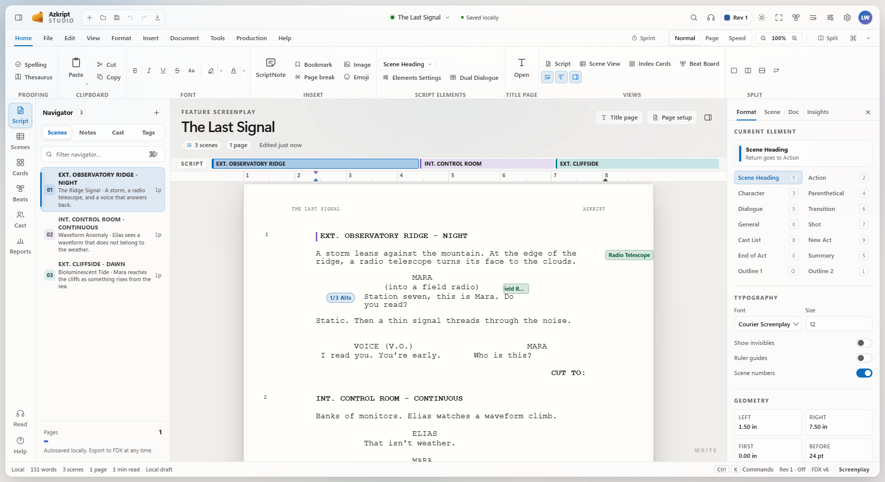
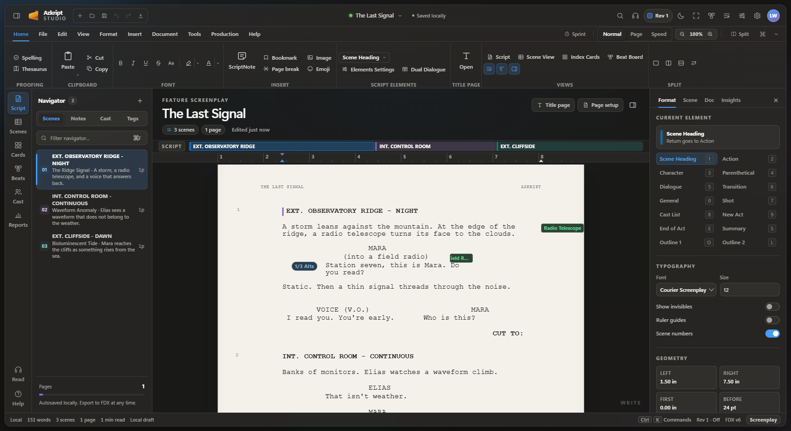
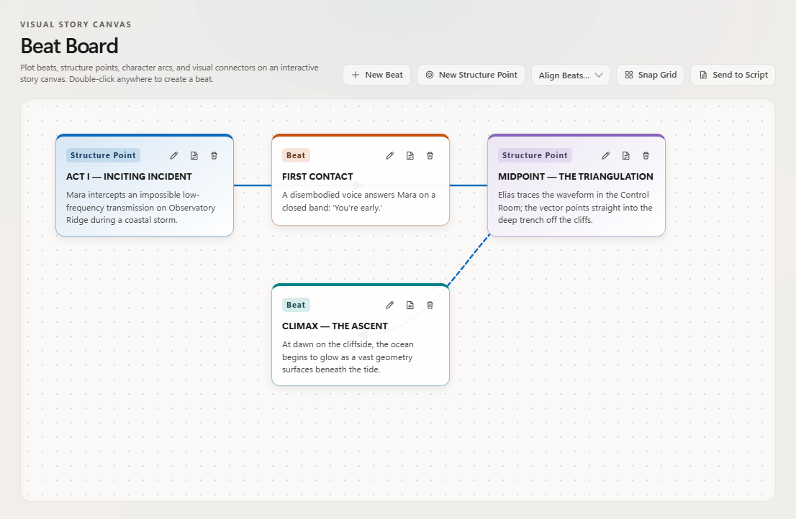
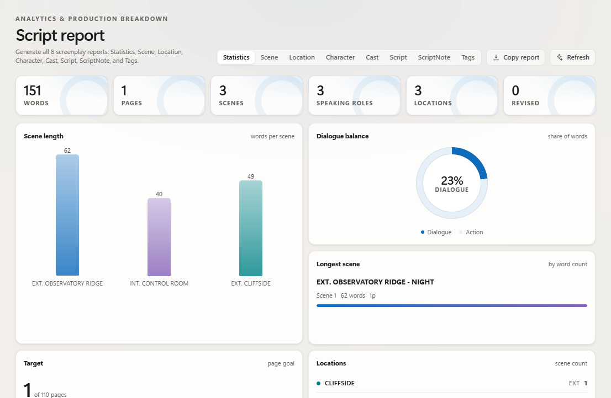

<div align="center">
  
  <h1>Azkript</h1>
  <p>A free, open-source screenplay studio for Windows.<br>Write in FDX, shape your story, and prepare it for production.</p>
  <p>
    <a href="https://github.com/darrenprx/azkript/releases">Windows releases</a> ·
    <a href="USER_GUIDE.md">User guide</a> ·
    <a href="DEVELOPMENT.md">Development</a> ·
    <a href="https://github.com/darrenprx/azkript/issues">Report a bug</a>
  </p>
  <p>
    
    
    <a href="LICENSE"></a>
  </p>
</div>



*The included sample, The Last Signal, open in the writing workspace. Screenshots show the current browser interface; the Windows app adds native file handling.*

## Your screenplay, in FDX

FDX is the XML-based screenplay format used by Final Draft; FDXT is its template
format. Azkript reads and writes these formats, so you can work with existing
scripts and save your screenplay as FDX. See [Final Draft's format descriptions](https://kb.finaldraft.com/hc/en-us/articles/27525594609684-How-do-I-export-a-Final-Draft-file-to-a-different-format-like-RTF-or-TXT).

Azkript implements its own editor and pagination. It is independently developed
and is not affiliated with Final Draft or its publisher. Support for FDX does
not guarantee identical pages, line breaks, or every Final Draft feature.
Azkript-specific notes, planning data and embedded media live in an `AzkriptData`
extension inside the file; other editors may discard that material. Keep an
original copy when moving a draft between applications.

## Get Azkript

Find published builds on the [Windows releases page](https://github.com/darrenprx/azkript/releases).
Official Azkript downloads are free, with no paid edition or subscription.

| Choose | What you get |
| --- | --- |
| **Installer** | A per-user Windows installation with Start Menu access and Open With registration. Existing file defaults are preserved. |
| **Portable** | Run the executable without installing. Settings and recovery data still use a local profile. |

> **Windows x64 beta · Unsigned builds.** Windows may show a security warning.
> Keep independent backups and use copies of important scripts while assessing
> a build. Physical IME, real screen-reader behavior, visible installer-wizard
> acceptance and signed cross-version upgrade/rollback remain unverified.
> See the [release procedure and acceptance limits](RELEASING.md).

## Write

Screenplay paragraph types, SmartType, scene navigation and page view keep the
draft close at hand. Use native Open and Save, recovery drafts, named milestones
and scene/dialogue comparisons as your script changes.

| While drafting | When sharing |
| --- | --- |
| Scene notes, scratchpad and unified search | Title pages and PDF export with preflight |
| Saved layouts and multi-script projects | FDX/FDXT and previewed Fountain exchange |
| Light, dark and Midnight themes | Clean review copies and offline comments |

<details>
<summary>See the dark writing workspace</summary>



</details>

## Plan



*Arrange beats and connect story turns on the canvas.*

Use index cards and scene-linked timelines to explore structure. Story studio
adds continuity facts, character arcs, alternate scene orders, pacing maps,
storyboards and rehearsal tools. Continuity comes from writer-entered evidence;
timing is estimated.

## Prepare



*Inspect scene lengths and dialogue balance before preparing the next draft.*

Production tools include issued A/B pagination, stable scene numbers, revision
PDF packets, breakdown CSV and department reports. Table reads use installed
speech voices; offline review packets carry comments and draft approvals.
See the [user guide](USER_GUIDE.md) for workflows, supported metadata and limits.

## Start writing

1. Open the Windows app and try the included sample, start a script, or open a copy of an `.fdx` file.
2. Choose paragraph types as you write; use the scene navigator, cards or beat board to explore the draft.
3. Save your screenplay as FDX. Export a PDF when you need a reading copy.

Your work stays local. Read about [data storage and privacy](PRIVACY.md).

## Build and contribute

With Node.js 22.12+ and npm 10+:

```powershell
npm ci
npm start
```

Windows is the primary desktop target. You can also open `app/index.html` in a
browser. The [development guide](DEVELOPMENT.md) covers tests, Python format
tools, brand assets and Windows packaging.

[Contributing](CONTRIBUTING.md) · [Security reports](SECURITY.md) · [Release procedure](RELEASING.md)

## License

Copyright (C) 2026 Darren Meng. Azkript's original code and `fdformat` tools are
licensed under [GNU GPL v3 only](LICENSE), with no warranty. You may use, modify
and redistribute them under those terms; distributed derivatives must provide
corresponding source under GPLv3. Commercial redistribution is permitted.

[Third-party notices](THIRD_PARTY_NOTICES.md) cover dependencies. The license does
not grant rights to vendor applications, proprietary templates, fonts or other
excluded assets.
