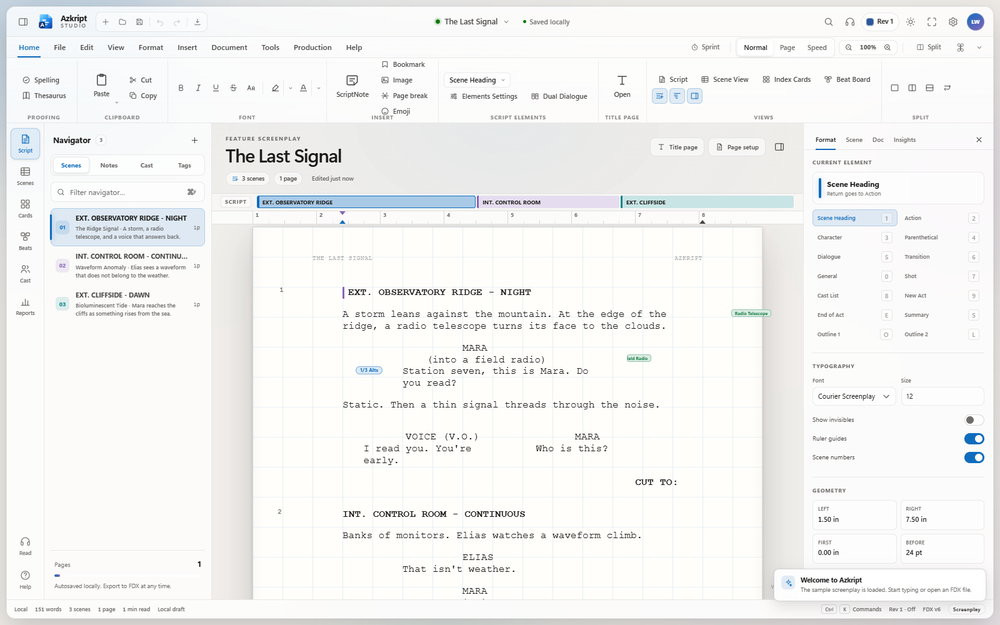

# Azkript

Azkript is a Windows desktop screenplay editor with a browser interface and
FDX/FDXT file support. It is an independent application and is not affiliated
with Final Draft or its publisher.



## Features

- Screenplay editing with paragraph types, keyboard shortcuts and SmartType.
- Page view, scene navigation, index cards and a beat board.
- Native Open, Save and Save As, recent documents and recovery drafts.
- Title pages, revision marks, Find and Replace, reports and PDF export.
- FDX/FDXT import/export, including supported production metadata.
- Light and dark themes, configurable appearance and OS speech voices.
- Portable Windows app and a per-user installer.

## Development

Use Node.js 22 or newer and npm. Windows is the primary desktop target.

```powershell
npm ci
npm start
```

The browser interface can also be opened from `app/index.html`.

`npm ci` installs the pinned test runtime. Existing test entry points use an
ignored compatibility directory that is prepared automatically; no separate
research checkout is required.

## Tests

Python 3.10 or newer and Pillow are used by the file-format and icon tests.
Browser checks require Chrome; set `CHROME_PATH` when it is installed elsewhere.

```powershell
python -m pip install -r requirements-dev.txt
npm test
python -m unittest discover -s tests -v
npm run test:ui
```

GitHub Actions runs the JavaScript and Python source tests on Windows.
Automated accessibility checks inspect Chromium's accessibility backend;
physical input methods and real screen-reader behavior require separate
interactive acceptance tests.

## Windows builds

```powershell
npm run package:win
npm run verify:release
```

Build outputs are written to `dist/`:

- `Azkript-1.0.0-portable.exe`
- `Azkript-Setup-1.0.0.exe`
- `win-unpacked/Azkript.exe`

The installer registers Azkript under Open With while preserving existing file
defaults. Uninstall keeps user data. Builds are currently unsigned.

## File-format tools

The optional `fdformat` Python package provides dependency-free inspection and
conversion utilities for FDX/FDXT and `.fddat` files:

```powershell
python -m fdformat --help
```

## Scope

FDX/FDXT compatibility and pagination are implemented independently. Exact
page/line parity with other editors is not guaranteed. Some native metadata can
be preserved or edited without reproducing every originating-editor feature.
Table read depends on the voices installed on the computer.

Design documents, plans, research material, local reports, machine-specific
operations, dependencies and generated builds are kept outside version control.
The application is not currently offered under an open-source license.
